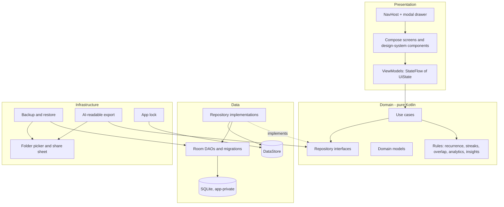

# Architecture Context

| | |
|---|---|
| **Version** | 0.1 (Draft, derived from PRD v0.1) |
| **Status** | Documentation phase. No code exists yet. |
| **Last updated** | 2026-10-24 |

> Read this file before changing any structure, dependency, storage model, or navigation. The **Invariants** section (section 14) must never be violated. If an implementation needs to break one, stop and amend this document first.

Version numbers are intentionally absent. Before the first build, verify current stable and mutually compatible releases of Kotlin, Compose, Room, Navigation, and Gradle against official Android documentation, and pin them in the Gradle version catalog.

---

## 1. Stack

| Layer | Technology | Role |
|---|---|---|
| Language | Kotlin | Single language for all app code |
| UI | Jetpack Compose + Material 3 (heavily customized) | Declarative UI; Material 3 supplies behavior, our design system supplies the look |
| Navigation | Navigation Compose | One activity, modal drawer, top-level destinations |
| Database | Room over SQLite | Authoritative local store, in app-private storage, unencrypted in v1 |
| Preferences | DataStore | Small settings only (theme id, default view, week start, backup bookkeeping) |
| Async | Kotlin Coroutines and Flow | Structured concurrency; reactive reads from Room |
| Presentation state | AndroidX ViewModel + Lifecycle | One ViewModel per screen, exposing `StateFlow<UiState>` |
| Dates and times | `java.time` | Available natively from API 26, so no extra date library |
| Serialization | kotlinx.serialization (JSON) | Backup manifest and export; one small dependency (see ADR) |
| Archive | `java.util.zip` | Backup archive; platform, no dependency |
| Crypto | Android/JDK `javax.crypto` primitives | Optional password-encrypted backup: PBKDF2-HMAC-SHA256 key derivation and AES-256-GCM (see `PRIVACY_SECURITY.md`). No custom cryptography |
| Files | Storage Access Framework (folder picker, persisted tree permission) | Backup destination chosen by the user |
| Dependency injection | Manual (`AppContainer`) | No framework; see section 12 |
| Build | Gradle Kotlin DSL with a version catalog | Single `app` module |
| Testing | JUnit, Room/Android instrumentation tests, Compose UI tests | See `TEST_PLAN.md` |
| Charts (P3) | Native Compose Canvas drawing (proposed, ADR-015) | Heatmap, line and bar charts; a library only if justified by an ADR |
**Platform:** minimum Android 8.0 (API 26). Target and compile versions follow current official guidance when development starts.

---

## 2. Architecture overview

Layered MVVM with a pure-Kotlin domain layer. Dependencies point inward: presentation depends on domain, data depends on domain, domain depends on nothing Android-specific.



---

## 3. Layer responsibilities

### Presentation
- Compose screens and reusable components; ViewModels; navigation.
- ViewModels expose immutable `UiState` through `StateFlow` and accept user intents as plain function calls.
- No business rules and no direct DAO access. UI code only formats and displays.

### Domain
- Business rules, use cases, scheduling and recurrence calculations, streak logic, analytics, insight rules, overlap detection.
- Plain Kotlin and `java.time` only. **No `android.*` imports.**
- Defines repository interfaces and domain models. Entities from Room never leave the data layer.

### Data
- Room entities, DAOs, migrations, mappers between entities and domain models, repository implementations, DataStore access.
- The only layer that knows SQL, entity classes, or preference keys.

### Infrastructure
- Backup and restore, AI-readable export, app lock, SAF access, share-sheet integration.
- Depends on data and domain through interfaces. Contains the Android-specific glue that does not belong in the data layer.

---

## 4. System boundaries and package structure

Single Gradle module `app`, organized by layer then by feature. Boundaries are enforced by conventions, review, and a dependency-check unit test (see `code-standards.md`), not by module splitting.

```
app/src/main/java/{base-package}/
  PersonalOsApp.kt            Application class: builds AppContainer
  MainActivity.kt             Single activity: theme, app lock gate, NavHost
  di/                         AppContainer and ViewModel factories (manual DI)
  navigation/                 Routes, NavHost, drawer destinations
  core/
    designsystem/             Theme, tokens, Pos* components (only place for styling primitives)
    time/                     Clock abstraction, date helpers, week-start logic
    result/                   AppResult and error types
    util/                     Small pure helpers
  domain/
    model/                    Task, TimeBlock, Habit, Goal, Note, Resource, ...
    repository/               Repository interfaces
    usecase/                  One class per use case
    rules/                    recurrence/, streak/, overlap/, analytics/, insight/
  data/
    local/                    PersonalOsDatabase, entity/, dao/, migration/, converters
    repository/               Repository implementations and mappers
    prefs/                    DataStore wrapper (settings, backup bookkeeping)
  infra/
    backup/                   Archive writer/reader, manifest, checksum, optional encryption
    export/                   AI-readable export generators (one per module)
    lock/                     App lock
    storage/                  SAF helpers
  feature/
    planner/                  Home: tasks view and timetable view, Now/Next, banner
    tasks/
    timetable/                Time blocks, day/week/month calendar
    habits/                   (P2)
    goals/                    (P2)
    notes/                    (P2)
    resources/                (P2)
    analytics/                (P3)
    settings/                 Theme, defaults, backup, privacy, about
```

Each `feature/<name>/` contains: `<Name>Screen.kt`, `<Name>ViewModel.kt`, `<Name>UiState.kt`, and a `components/` folder for feature-specific composables. Features do not import from each other; shared UI goes to `core/designsystem`, shared logic goes to `domain`.

Finance (P4) will add `feature/finance`, `domain/.../finance`, and finance tables. Nothing for finance exists before then.

---

## 5. Repository boundaries

One repository per aggregate root. A repository exposes domain models and `Flow`s; it never exposes entities, DAOs, or cursors.

| Repository | Owns | Notes |
|---|---|---|
| `TaskRepository` | tasks, subtasks, task tags, recurrence rules for tasks | Completion of a recurring occurrence is handled here, atomically |
| `TimeBlockRepository` | time blocks and recurring schedule entries | Link to a task by id |
| `TagRepository` | tags shared by tasks, notes, resources | Single tags table |
| `HabitRepository` (P2) | habits, habit entries, trackers | |
| `GoalRepository` (P2) | goals, milestones, projects | |
| `NoteRepository` (P2) | notes, journal entries, links | |
| `ResourceRepository` (P2) | resources, collections | URL strings only |
| `SettingsRepository` | DataStore preferences | Theme id, defaults, backup bookkeeping |
| `BackupRepository` | backup and restore operations | Infrastructure-facing; coordinates DAOs in one transaction for restore |

Rules:
- A repository may call DAOs of its own aggregate only. Cross-aggregate reads happen in use cases that combine repositories.
- Operations that change several rows or tables run inside one Room transaction, opened in the repository.
- Repositories take no `Context` unless unavoidable. Anything needing `Context` lives in `infra/`.

---

## 6. Data flow

**Read path (reactive):**
`Room DAO Flow` -> `Repository (maps to domain)` -> `Use case (optional combine/rules)` -> `ViewModel (stateIn, UiState)` -> `Compose (collectAsStateWithLifecycle)`.

**Write path (user intent):**
`Compose event` -> `ViewModel function` -> `Use case` -> `Repository` -> `Room transaction (off main thread)`. The UI does not wait for or depend on an optimistic copy; Room's Flow re-emits and the UI updates. Because Room is local and fast, there is no separate in-memory source of truth.

**One source of truth:** each record exists once, in Room. ViewModels hold only transient UI state (text being typed, expanded/collapsed, selected filter, sheet open). Drafts that must survive process death (notes being edited) are autosaved to Room.

**UI state shape:** one immutable `UiState` data class per screen. One-off effects (show snackbar, navigate) are modeled as state that the UI consumes and acknowledges, not as fire-and-forget channels.

---

## 7. Offline-first behavior

- There is no network layer. The app declares no INTERNET permission, so no component can reach the network by accident.
- Every operation completes against local storage; nothing waits on a server.
- Opening a saved URL uses `Intent.ACTION_VIEW`, so the user's browser or Drive app makes the connection, not this app.
- Sharing an export or opening a backup folder goes through Android's share sheet and folder picker.

---

## 8. Database access strategy

- Room with one `PersonalOsDatabase` instance created once in `AppContainer`.
- DAOs return `Flow` for observed data and `suspend` functions for writes. Room moves these off the main thread.
- Queries are shaped for the screen: indexed columns for due date, status, date, and foreign keys; paged or limited queries for long histories.
- Foreign keys enabled; deletion behavior defined per table in `DATABASE_SCHEMA.md`.
- Schema export enabled; exported schema JSON is committed and used by migration tests.
- Migrations are explicit and tested from the first release. Destructive fallback is forbidden.
- No data operation touches the main thread. No `allowMainThreadQueries`.

---

## 9. Backup, restore, export, and nudge

### Backup and restore
- Backup creates a ZIP archive containing a manifest (app version, backup schema version, creation time, record counts), data files, and a checksum. Optional password encryption wraps the archive.
- The user picks a destination folder once through the folder picker; the persisted tree URI is stored in DataStore. This is a backup folder only and is unrelated to the "URLs only" rule for resources.
- Backup is written to a temporary file in the destination, then renamed. A crash mid-write leaves a clearly named temporary file that is ignored and cleaned up later.
- Restore: open archive, verify format, version, and checksum, decrypt if needed, **validate fully before touching the database**, then replace data inside a single transaction. On any failure the existing database is untouched.
- Retention: keep the most recent **5** backups matching the app's own file-name pattern and remove older ones. Encrypted files use the `.zip.enc` suffix.
- Long operations run in an application-scoped coroutine so a configuration change does not cancel them. They show progress in the UI and do not use a foreground service or WorkManager.

### Backup nudge (FR-NTF)
- On app open, the planner ViewModel reads `lastBackupAt` and a `dirtySinceBackup` flag from DataStore.
- `dirtySinceBackup` is set by a Room `InvalidationTracker` observer registered once on all user tables (any insert, update, or delete marks the database dirty), debounced before persisting. This avoids relying on per-table `updated_at` columns, which would miss deletes. Exact behavior is a verification task on a real device.
- The banner shows when `now - lastBackupAt > 5 days` and `dirtySinceBackup` is true. A fresh install with no data never shows it. - Dismissal snoozes the banner for **24 hours**.
- There is no scheduler, no alarm, no worker, and no system notification.

### AI-readable export (P3)
- One `ModuleExporter` per module produces a Markdown/TXT section and optionally CSV. An `ExportBuilder` combines selected modules and date range, plus the summary header.
- Output is streamed to the user-chosen destination or share intent, to avoid holding very large histories in memory.
- This is independent of backup and is not re-importable.

---

## 10. Background processing policy

- v1 has **no** background work: no WorkManager, no services, no alarms, no boot receivers, no broadcast receivers beyond what the platform requires for a normal activity.
- Anything periodic is evaluated lazily when the app opens.
- Long user-initiated operations (backup, restore, export) run in an application-scoped coroutine with visible progress.
- Adding any background mechanism requires an ADR and an update to `PRIVACY_SECURITY.md`.

---

## 11. Error handling and logging

**Error handling**
- Expected failures (invalid input, corrupt backup, wrong password, full storage, unreachable folder) are values: a sealed `AppResult` or typed error, not exceptions thrown across layers.
- Each error type has a user-facing message defined in one place and an action when one exists (retry, choose another folder).
- Unexpected exceptions are caught at coroutine boundaries owned by the ViewModel or infrastructure operation, turned into a generic error state, and never silently swallowed.
- Writes show clear failure rather than appearing to succeed.

**Logging (privacy-consistent)**
- Logging goes through one wrapper. Release builds log nothing that includes user content (titles, notes, URLs, amounts).
- Debug logs may name operations and record counts, never record contents.
- No crash-reporting SDK and no remote log upload.

---

## 12. Dependency management

**Policy:** every dependency must be justified in an ADR by purpose, maintenance status, size effect, and network behavior. No dependency is added merely because it is popular. Transitive dependencies are reviewed for network access.

**Allowed baseline (proposed, to be confirmed in ADRs):**

| Dependency | Purpose |
|---|---|
| Compose UI, foundation, Material 3 | UI |
| Navigation Compose | Navigation |
| Lifecycle (ViewModel, runtime-compose) | State and lifecycle-aware collection |
| Room (runtime, ktx, compiler) | Database |
| DataStore (Preferences) | Settings |
| Kotlin Coroutines | Concurrency |
| kotlinx.serialization (JSON) | Backup manifest and export |
| Test: JUnit, AndroidX Test, Compose UI test, Room testing | Testing |

**Pending decisions:** biometric/device-credential app lock (`androidx.biometric` versus platform-only approach, since the framework prompt needs a later API level than our minimum), and charting library for P3.

**Not allowed without explicit approval:** any networking library, image-loading library, analytics, crash reporting, ads, AI SDK, Firebase, DI framework, or large icon pack.

**Manual DI:** `AppContainer` constructs the database, repositories, and settings once; ViewModel factories receive what they need from it. Hilt is not used unless a demonstrated benefit appears.

---

## 12a. Navigation architecture

- Single `MainActivity` with one `NavHost`. A modal navigation drawer wraps the top-level scaffold.
- Top-level destinations (drawer entries): Home/Today (start destination), Calendar, Tasks, Timetable, Habits, Goals and Projects, Notes and Journal, Resources, Analytics, Settings. Entries for modules not yet built are not shown.
- The Tasks/Timetable switch on the planner is **state inside the planner destination**, not two destinations, so switching is instant and scroll state is retained.
- Switching top-level destinations saves and restores state and avoids duplicate instances (single-top, save/restore state).
- Back: closes the drawer first, then pops the back stack; from a top-level destination returns to the planner, then exits.
- Create/edit forms open as bottom sheets or dialogs when simple, and as dedicated screens when complex. Their arguments are record ids, never whole objects.
- Drawer entries come from a single list so a destination is added in one place.
- App lock, when enabled, gates `MainActivity` content before the NavHost is shown.

---

## 13. Performance strategy

- Lazy lists with stable keys for all long collections; no eager loading of histories.
- Indexed queries, limits, and paging on tasks, activity, and later transaction histories.
- State hoisting and stable immutable models to limit recomposition; `UiState` classes are immutable.
- Expensive work (analytics, export, backup) runs off the main thread on a dispatcher injected through `AppContainer` so tests can control it.
- Animations use built-in Compose APIs only; offsets and shadows are cheap draw operations, not blur.
- Release builds use R8 shrinking and resource shrinking; measure the release artifact, not debug.
- Startup: build `AppContainer` lazily where possible; avoid work in `Application.onCreate` beyond constructing the container.
- Targets are measured per `TEST_PLAN.md`; no performance claim is made without a measurement.

---

## Storage Model

- **Room/SQLite (app-private):** all user records, in normalized tables. Authoritative. Unencrypted in v1.
- **DataStore:** small settings and backup bookkeeping only (`lastBackupAt`, `dirtySinceBackup`, backup folder URI, theme id, defaults, app-lock flag, nudge snooze). Never user content.
- **User-chosen backup folder (SAF):** backup archives only, owned by the user.
- **No other storage:** no linked documents, no attachments, no caches of user content, no app-managed file copies.
- **Resources:** URL strings in Room. Nothing is downloaded or stored beyond the string.

---

## Auth and Access Model

- There is no authentication, account, or server. The user is the device owner.
- Access control is Android's app sandbox plus the optional **app lock**, which gates the UI. It is a lock, **not** encryption, and is never described as such.
- Data at rest is protected only by app-private storage and device-level encryption, if the device has it. Optional backup encryption protects exported archives only.
- All of the above is stated honestly on the in-app privacy screen. Details and limits are in `PRIVACY_SECURITY.md`.

---

## 14. Invariants

1. The domain layer imports nothing from `android.*`, Compose, Room, or DataStore.
2. Room entities and DAOs never appear outside the `data` layer.
3. The app has no INTERNET permission and no component makes network requests. This is checked in every release audit.
4. No AI model, AI API, telemetry, advertising, or analytics SDK is present, ever, without an explicit ADR.
5. All database access is off the main thread; no `allowMainThreadQueries`.
6. Each record has exactly one source of truth in Room; ViewModels hold only transient UI state.
7. Changes spanning multiple rows or tables happen in one transaction.
8. Date-only values stay date-only; instants are UTC; the two are never mixed (see `DATABASE_SCHEMA.md`).
9. Money, when added in P4, is stored as integer minor units; floating point is never used for amounts. No finance structures exist before P4.
10. Restore validates fully before it changes any data and is atomic.
11. No background work (workers, services, alarms) and no system notifications in v1.
12. Colors, spacing, radii, and type come from design tokens; feature code never hardcodes them.
13. Resources store URLs only; the app never stores file paths or links to local documents.
14. Logs never contain user content.
15. Schema changes ship with a tested migration; destructive migration is forbidden.

---

## 15. Future extensibility

- **P2 to P3:** new features add a `feature/` package, a repository, domain models and rules, and tables via migration. Drawer entry, backup inclusion, and export section are each added in one place.
- **Backup schema** is versioned independently of the Room schema so older backups can be read by newer versions through explicit upgraders.
- **Finance (P4):** added as a new vertical slice with its own tables, repositories, and rules. The ledger design (integer minor units, transfers as linked entries, transactional balance updates) is specified in `DATABASE_SCHEMA.md` ahead of time but not implemented.
- **Possible later items** (each needs approval and an ADR): database encryption, a single opt-in daily notification, home-screen widget, optional sync. The design avoids sync-specific tables and does not preclude them.

---

## 16. Decisions rejected

| Rejected | Reason |
|---|---|
| Flutter, React Native, web wrapper | Chose native Kotlin for size, platform fit, and fewest layers |
| Hilt or other DI framework | Manual DI is sufficient for one module; fewer dependencies and less build overhead |
| WorkManager, alarms, foreground services | No v1 feature needs them; backup nudge is computed on app open |
| System notifications in v1 | In-app banners and strips meet the need without permissions or scheduling |
| Multi-module Gradle project | Extra build complexity not justified for one app and one developer; revisit if build times suffer |
| SQLCipher or other database encryption in v1 | Adds size and key-recovery complexity; honest app lock plus encrypted backups chosen instead; schema stays compatible with adding it |
| Firebase, Supabase, any backend | Contradicts offline-first and privacy principles |
| Retrofit, OkHttp, image-loading libraries | No network use and no remote images |
| Event bus, MVI framework, microservice-style layering | Complexity without benefit at this size |
| Large icon pack (for example extended Material icons) | Size cost; use a curated set of vector drawables unless measured otherwise |
| Storing local file paths for resources | Paths break; resources are URLs only |
| Automatic scheduled backup via background worker | Conflicts with no-background policy; nudge and manual backup instead |

---

## 17. Open architecture questions

| AQ-01 | Confirm `InvalidationTracker`-based dirty flag on a real device, including debounce and process-death behavior | P1 backup task (open) |
| AQ-02 | Resolved: system biometric or device credential via the AndroidX biometric library; verify on older Android (SV-02) | `PRIVACY_SECURITY.md` |
| AQ-03 | Resolved: PBKDF2-HMAC-SHA256 plus AES-256-GCM, 32 MiB ceiling (SV-03, SV-04) | `PRIVACY_SECURITY.md` |
| AQ-04 | Resolved: floating local time for blocks | `DATABASE_SCHEMA.md` |
| AQ-05 | Proposed: native Canvas charts (ADR-015); confirm at P3 start | Before P3 |
| AQ-06 | Record the outcome of the layer-boundary test from T-003 | Tracker |