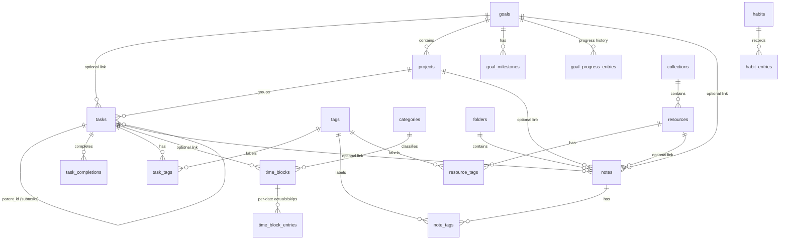

# Life kernel — Database Design

| | |
|---|---|
| **Version** | 0.1 (Draft, derived from PRD v0.1 and ARCHITECTURE v0.1) |
| **Status** | Documentation phase. Nothing here has been built or run. |
| **Storage** | Room over SQLite, app-private storage, unencrypted in v1 |
| **Last updated** | 2026-10-24 |

> The schema is designed for phases P1 to P3 so that later phases fit without rework. Tables are **created phase by phase** through migrations; nothing is created before its phase needs it. Finance (P4) is specified in section 12 as reserved design only. No finance table exists before P4.

---

## 1. Decisions that resolve open questions

| ID | Decision | Rationale |
|---|---|---|
| DB-01 | Primary keys are `INTEGER` auto-generated. No UUIDs in v1. | Simplest and fastest. Restore replaces all data and keeps ids exactly, so ids are stable across backups. A future sync feature can add a UUID column through a migration. |
| DB-02 | **Date-only** values are `TEXT` in ISO form `YYYY-MM-DD`. | Sorts and compares correctly as text, is readable in exports and backups, and has no time zone to shift. |
| DB-03 | **Instants** are `INTEGER` epoch milliseconds in UTC. | Unambiguous and cheap to compare. |
| DB-04 | Time blocks use **floating local time**: a date, a start minute of the day, and a duration in minutes. They are not stored as instants. | A "18:00 gym" block should stay at 18:00 when the user travels or the zone changes. Resolves OQ-04. |
| DB-05 | A time block belongs to its **start date** and may run past midnight (duration up to 1440 minutes). | Supports night blocks like 23:00 to 07:00 without splitting rows. |
| DB-06 | A model day is always 1440 minutes. DST is **not** applied to time blocks. Actual durations are entered as minutes, not derived from clock times. | Avoids DST corruption of durations. On the two DST days a year, a block's wall-clock display can be off by an hour relative to real elapsed time. This is documented and accepted. |
| DB-07 | Completion records snapshot the **local date** (`completed_on`) next to the UTC instant. | Daily statistics stay stable if the device time zone later changes. |
| DB-08 | **No soft deletion and no tombstones** in v1. Deleting is permanent. "Archive" is a user-visible state on selected tables, not a hidden delete. | No sync exists to need tombstones. Keeps queries simple. |
| DB-09 | Ordered enums are stored as `INTEGER` codes, unordered enums as stable `TEXT` codes, never as ordinals of a Kotlin enum that could be reordered. Code tables are in section 5. | Safe against refactors; sorting by priority works in SQL. |
| DB-10 | **No `CHECK` constraints** in the database in v1. Ranges and rules are enforced in the domain layer and tested. | To my knowledge Room entity annotations cannot declare CHECK constraints, and hand-added checks would differ between migrated and fresh databases. Verify during M2. Foreign keys, unique constraints, and NOT NULL are used. |
| DB-11 | `custom_trackers` and `tracker_schedules` from the initial list are **merged into `habits`** (a habit with kind and an optional target; a flexible-schedule habit is a pure tracker). | One concept, one table, one streak engine. |
| DB-12 | `activity_logs` is **not a table**. Daily activity is derived from existing records (task completions, habit entries, notes created, time-block actuals). | A separate log would duplicate state and drift out of sync. |
| DB-13 | `note_links` is replaced by nullable foreign keys on `notes` (goal, project, task, resource) plus a linked date. | Real foreign-key integrity instead of a polymorphic id. Limitation: at most one link per type per note. |
| DB-14 | Tags are shared by tasks, notes, and resources. A tag with no remaining references is removed in the same transaction that removed its last use. | No orphan clutter in the tag picker. |
| DB-15 | There is **no `app_meta` table**. Settings and backup bookkeeping live in DataStore. | Keeps user data separate from device-local state. |
| DB-16 | Account balances (P4) are **derived**, never stored. | A stored balance can drift from transactions; derivation cannot. |

---

## 2. Conventions

### 2.1 Common columns
- `id INTEGER PRIMARY KEY AUTOINCREMENT` on every entity table.
- `created_at INTEGER NOT NULL` and `updated_at INTEGER NOT NULL` (UTC ms) on user-editable entity tables. They are set by the repository from the injected `Clock`, never by SQL defaults.
- Join tables use a composite primary key and no `id`.

### 2.2 Date, time, and time zone rules
| Kind | Storage | Examples | Time zone behavior |
|---|---|---|---|
| Date-only | `TEXT` `YYYY-MM-DD` | `due_date`, habit entry `date`, `journal_date`, `completed_on` | Never converted. Does not shift if the zone changes. |
| Instant | `INTEGER` UTC ms | `created_at`, `updated_at`, `completed_at`, `recorded_at` | Converted to the device zone for display only. |
| Floating time of day | `INTEGER` minutes `0..1439` on a date | `start_minute` | Wall-clock; never converted. |
| Duration | `INTEGER` minutes | `duration_minutes`, `actual_minutes` | Never derived from clock subtraction across DST. |

- "Today" is computed at read time from the injected `Clock` and the device's current zone. Changing the zone changes what "today" means, not any stored value.
- Week start (Monday or Sunday) is a setting and affects only grouping at query time.
- Leap years and month ends are handled by `java.time`; stored dates are always valid calendar dates (validated in the domain and on restore).
- Types whose statistics matter keep a local-date snapshot beside the instant: `task_completions.completed_on`, `notes.created_on`, `goal_milestones.completed_on`.

### 2.3 Naming and typing
- Tables and columns in `snake_case`; tables plural.
- Booleans are `INTEGER` 0 or 1, `NOT NULL DEFAULT 0` unless stated.
- Free text is `TEXT`; empty strings are allowed only where stated, otherwise use `NULL`.
- Real-number values (habit measurements, goal numeric values) are `REAL`. Money never uses `REAL` (see section 12).
- Text columns that must be unique case-insensitively use `COLLATE NOCASE`.

### 2.4 Domain validation limits (proposed)
Enforced in the domain layer and again, as plausibility checks, on restore.

| Field | Limit |
|---|---|
| Titles and names | 1 to 200 characters |
| Description and notes text on tasks, goals, habits, resources | 0 to 10,000 characters |
| Note body | 0 to 200,000 characters |
| Tag name | 1 to 40 characters |
| URL | 1 to 2,048 characters |
| `duration_minutes` | 1 to 1,440 |
| `start_minute` | 0 to 1,439 |
| `recur_interval` | 1 to 365 |

---

## 3. Entity-relationship diagram (P1 to P3)



---

## 4. Phase map

| Room version | Phase | Tables added |
|---|---|---|
| 1 | P1 (M2) | `tags`, `tasks`, `task_tags`, `task_completions` |
| 2 | P1 (M7) | `categories`, `time_blocks`, `time_block_entries` |
| 3+ | P2 | `collections`, `resources`, `resource_tags`; `folders`, `notes`, `note_tags`; `habits`, `habit_entries`; `goals`, `goal_milestones`, `goal_progress_entries`, `projects`; columns `tasks.project_id` and `tasks.goal_id` added |
| none | P3 | No new tables planned (analytics are queries and in-memory computations); indexes may be added |
| later | P4 | Finance tables per section 12 |

P2 migrations may be one or several versions, one per module, since modules are built one at a time. SQLite allows adding a column that has a foreign-key clause only when its default is `NULL`; the `tasks.project_id` and `tasks.goal_id` migration must be verified against Room's schema validation in a migration test.

---

## 5. Code tables

| Name | Type | Codes |
|---|---|---|
| Task status | INTEGER | 0 OPEN, 1 DONE |
| Priority | INTEGER | 0 NONE, 1 LOW, 2 MEDIUM, 3 HIGH (final set is DQ-01; adding a level needs no migration) |
| Recurrence type | INTEGER | 0 NONE, 1 DAILY, 2 WEEKLY, 3 MONTHLY |
| Weekday mask | INTEGER bitmask | Mon=1, Tue=2, Wed=4, Thu=8, Fri=16, Sat=32, Sun=64 |
| Habit kind | INTEGER | 0 BOOLEAN, 1 NUMERIC, 2 DURATION (value in minutes) |
| Habit schedule | INTEGER | 0 DAILY, 1 WEEKDAYS (mask), 2 EVERY_N_DAYS, 3 FLEXIBLE (no schedule) |
| Habit entry state | INTEGER | 0 DONE, 1 SKIPPED (intentional), 2 MISSED (explicitly recorded as not done) |
| Goal horizon | INTEGER | 0 SHORT, 1 MEDIUM, 2 LONG |
| Goal category | INTEGER | 0 CAREER, 1 LEARNING, 2 HEALTH, 3 PERSONAL, 4 FINANCE, 5 OTHER |
| Goal status | INTEGER | 0 ACTIVE, 1 COMPLETED, 2 PAUSED, 3 DROPPED |
| Goal progress method | INTEGER | 0 MANUAL, 1 NUMERIC, 2 MILESTONE, 3 TASKS |
| Project status | INTEGER | 0 ACTIVE, 1 COMPLETED, 2 ARCHIVED |
| Note kind | INTEGER | 0 NOTE, 1 JOURNAL |
| Resource type | INTEGER | 0 WEBSITE, 1 VIDEO, 2 ARTICLE, 3 DOCUMENT (an online document), 4 TOOL, 5 OTHER |

---

## 6. Tables — P1

### 6.1 `tags`
Shared labels for tasks, notes, and resources.

| Column | Type | Null | Default | Notes |
|---|---|---|---|---|
| id | INTEGER | no | auto | PK |
| name | TEXT COLLATE NOCASE | no | | Unique |
| created_at | INTEGER | no | | UTC ms |

Constraints and indexes: `UNIQUE(name)`. Deletion: removing a tag removes its join rows (`ON DELETE CASCADE` on the join tables).

### 6.2 `tasks`

| Column | Type | Null | Default | Notes |
|---|---|---|---|---|
| id | INTEGER | no | auto | PK |
| title | TEXT | no | | 1–200 chars |
| description | TEXT | yes | NULL | |
| status | INTEGER | no | 0 | 0 OPEN, 1 DONE. DONE is used only for non-recurring tasks |
| priority | INTEGER | no | 0 | |
| start_date | TEXT | yes | NULL | Date-only |
| due_date | TEXT | yes | NULL | Date-only. For a recurring task, the due date of the **next** occurrence |
| parent_id | INTEGER | yes | NULL | FK to `tasks(id)`; `ON DELETE CASCADE` |
| sort_order | INTEGER | no | 0 | Orders subtasks |
| recur_type | INTEGER | no | 0 | |
| recur_interval | INTEGER | no | 1 | "Every N days/weeks/months" |
| recur_weekdays | INTEGER | no | 0 | Weekday mask for WEEKLY |
| recur_until | TEXT | yes | NULL | Last date a recurrence may produce |
| created_at, updated_at | INTEGER | no | | |
| project_id | INTEGER | yes | NULL | **Added in P2.** FK `projects(id)` `ON DELETE SET NULL` |
| goal_id | INTEGER | yes | NULL | **Added in P2.** FK `goals(id)` `ON DELETE SET NULL` |

Indexes: `(status, due_date)`, `(parent_id)`, `(due_date)`; P2 adds `(project_id)`, `(goal_id)`.

Domain rules (tested, not DB-enforced):
- A subtask may not have its own subtasks (depth is 1).
- A recurring task may not have subtasks.
- A recurring task requires a `due_date`.
- A subtask's `parent_id` must reference an existing top-level task.

Deletion: deleting a task deletes its subtasks, its completion rows, and its tag links. Time blocks that referenced it keep existing with `task_id` set to NULL. Statistics for a deleted task disappear with it; this is intended.

### 6.3 `task_completions`
Every completion of a task or of a recurring occurrence. Single source of truth for "when was this done".

| Column | Type | Null | Default | Notes |
|---|---|---|---|---|
| id | INTEGER | no | auto | PK |
| task_id | INTEGER | no | | FK `tasks(id)` `ON DELETE CASCADE` |
| occurrence_date | TEXT | yes | NULL | The due date being completed; NULL if the task had none. Used to undo and to prevent double completion |
| completed_at | INTEGER | no | | UTC ms |
| completed_on | TEXT | no | | Local date at completion (DB-07) |

Constraints and indexes: `UNIQUE(task_id, occurrence_date)` (NULL values do not collide, so a task without a due date relies on the domain rule that it can be completed once), `(completed_on)`, `(task_id)`.

### 6.4 `task_tags`
| Column | Type | Notes |
|---|---|---|
| task_id | INTEGER | FK `tasks(id)` `ON DELETE CASCADE` |
| tag_id | INTEGER | FK `tags(id)` `ON DELETE CASCADE` |

Primary key `(task_id, tag_id)`; index on `(tag_id)`.

### 6.5 `categories` (Room version 2)
User-defined categories for time blocks, used by "time allocation by category".

| Column | Type | Null | Default | Notes |
|---|---|---|---|---|
| id | INTEGER | no | auto | PK |
| name | TEXT COLLATE NOCASE | no | | Unique |
| color_key | TEXT | yes | NULL | Key into a curated swatch set, not a theme color |
| sort_order | INTEGER | no | 0 | |
| created_at, updated_at | INTEGER | no | | |

### 6.6 `time_blocks` (Room version 2)

| Column | Type | Null | Default | Notes |
|---|---|---|---|---|
| id | INTEGER | no | auto | PK |
| title | TEXT | no | | |
| notes | TEXT | yes | NULL | |
| category_id | INTEGER | yes | NULL | FK `categories(id)` `ON DELETE SET NULL` |
| task_id | INTEGER | yes | NULL | FK `tasks(id)` `ON DELETE SET NULL` |
| date | TEXT | no | | Start date. For a recurring block, the first date of the series |
| start_minute | INTEGER | no | | 0–1439 |
| duration_minutes | INTEGER | no | | 1–1440; may pass midnight (DB-05) |
| recur_type, recur_interval, recur_weekdays, recur_until | | | | Same meaning as on `tasks` |
| created_at, updated_at | INTEGER | no | | |

Indexes: `(date)`, `(recur_type, date)`, `(task_id)`, `(category_id)`.

Domain rules: a recurring block cannot link a task; overlaps are detected, never blocked (FR-TIME-005).

### 6.7 `time_block_entries` (Room version 2)
Optional per-date data for a block occurrence: the actual duration, or a skipped occurrence of a recurring series. For a one-off block, the only possible date is the block's own date.

| Column | Type | Null | Default | Notes |
|---|---|---|---|---|
| block_id | INTEGER | no | | FK `time_blocks(id)` `ON DELETE CASCADE` |
| date | TEXT | no | | Occurrence date |
| actual_minutes | INTEGER | yes | NULL | Entered by the user |
| skipped | INTEGER | no | 0 | 1 = this occurrence is skipped |

Primary key `(block_id, date)`; index `(date)`.

Editing "this occurrence only" is not supported in v1. The user edits the series, or skips the occurrence and creates a standalone block.

---

## 7. Tables — P2

### 7.1 Habits
**`habits`**

| Column | Type | Null | Default | Notes |
|---|---|---|---|---|
| id | INTEGER | no | auto | PK |
| name | TEXT | no | | |
| description | TEXT | yes | NULL | |
| kind | INTEGER | no | 0 | BOOLEAN, NUMERIC, DURATION |
| schedule_type | INTEGER | no | 0 | DAILY, WEEKDAYS, EVERY_N_DAYS, FLEXIBLE |
| schedule_weekdays | INTEGER | no | 0 | Mask for WEEKDAYS |
| schedule_interval | INTEGER | no | 1 | N for EVERY_N_DAYS |
| start_date | TEXT | no | | Anchor for every-N schedules and the first date a miss can occur |
| end_date | TEXT | yes | NULL | |
| target_value | REAL | yes | NULL | For NUMERIC (in `unit`) and DURATION (minutes) |
| unit | TEXT | yes | NULL | |
| archived | INTEGER | no | 0 | |
| created_at, updated_at | INTEGER | no | | |

Index: `(archived)`.

**`habit_entries`**

| Column | Type | Null | Default | Notes |
|---|---|---|---|---|
| id | INTEGER | no | auto | PK |
| habit_id | INTEGER | no | | FK `habits(id)` `ON DELETE CASCADE` |
| date | TEXT | no | | Date-only |
| state | INTEGER | no | 0 | DONE, SKIPPED, MISSED |
| value | REAL | yes | NULL | Measurement or minutes |
| note | TEXT | yes | NULL | |
| recorded_at | INTEGER | no | | UTC ms |

Constraints and indexes: `UNIQUE(habit_id, date)`, `(date)`.

Semantics: **no row** for a date means "not recorded". A scheduled past date with no row is treated as missing, not as a recorded failure; `MISSED` is an explicit user statement. The analytics rules for how these differ are in `ANALYTICS_SPEC.md`. An unscheduled day is never a miss, which is computed from the schedule fields at query time, not stored.

### 7.2 Goals and projects
**`goals`**

| Column | Type | Null | Default | Notes |
|---|---|---|---|---|
| id | INTEGER | no | auto | PK |
| title | TEXT | no | | |
| description | TEXT | yes | NULL | |
| horizon | INTEGER | no | 0 | |
| category | INTEGER | no | 5 | |
| status | INTEGER | no | 0 | |
| progress_method | INTEGER | no | 0 | MANUAL, NUMERIC, MILESTONE, TASKS |
| numeric_start | REAL | yes | NULL | NUMERIC only |
| numeric_target | REAL | yes | NULL | NUMERIC only |
| unit | TEXT | yes | NULL | |
| target_date | TEXT | yes | NULL | |
| review_date | TEXT | yes | NULL | |
| completed_at | INTEGER | yes | NULL | |
| created_at, updated_at | INTEGER | no | | |

Indexes: `(status)`, `(target_date)`.

**Progress calculation (single definition, no stored percentage):**
- MANUAL: latest `goal_progress_entries.value` is a percentage 0–100.
- NUMERIC: `clamp((current - start) / (target - start), 0, 1)` with `current` the latest entry value. Works for increasing and decreasing targets. If `start == target`, progress is undefined and shown as "set a valid target".
- MILESTONE: completed milestones divided by total milestones. With zero milestones, progress is "no milestones", not 0% or 100%.
- TASKS: share of linked tasks that are complete. Used only when the user explicitly selects this method.

**`goal_milestones`**: `id`, `goal_id` (FK cascade), `title`, `due_date` (NULL), `completed_at` (NULL, UTC ms), `completed_on` (NULL, local-date snapshot set together with `completed_at`), `sort_order`, `created_at`. Index `(goal_id)`.

**`goal_progress_entries`**: `id`, `goal_id` (FK cascade), `date` (TEXT), `value` (REAL, not null), `note` (NULL), `recorded_at`. `UNIQUE(goal_id, date)`; a second update on the same day replaces the first. Provides history for "goal progress over time".

**`projects`**: `id`, `title`, `description` (NULL), `goal_id` (FK `goals` `ON DELETE SET NULL`), `status` (default 0), `start_date`, `target_date` (NULL), `created_at`, `updated_at`. Indexes `(goal_id)`, `(status)`.

### 7.3 Notes
**`folders`**: `id`, `name` (NOCASE, unique), `sort_order`, `created_at`.

**`notes`**

| Column | Type | Null | Default | Notes |
|---|---|---|---|---|
| id | INTEGER | no | auto | PK |
| kind | INTEGER | no | 0 | NOTE or JOURNAL |
| title | TEXT | yes | NULL | |
| body | TEXT | no | '' | Raw text; Markdown is rendered, not stored as HTML |
| journal_date | TEXT | yes | NULL | Set for JOURNAL only. `UNIQUE`, so one journal entry per date (NULLs do not collide) |
| folder_id | INTEGER | yes | NULL | FK `folders(id)` `ON DELETE SET NULL` |
| pinned | INTEGER | no | 0 | |
| archived | INTEGER | no | 0 | |
| goal_id | INTEGER | yes | NULL | FK `goals(id)` `ON DELETE SET NULL` |
| project_id | INTEGER | yes | NULL | FK `projects(id)` `ON DELETE SET NULL` |
| task_id | INTEGER | yes | NULL | FK `tasks(id)` `ON DELETE SET NULL` |
| resource_id | INTEGER | yes | NULL | FK `resources(id)` `ON DELETE SET NULL` |
| linked_date | TEXT | yes | NULL | Date association for plain notes |
| created_at, updated_at | INTEGER | no | | |
| created_on | TEXT | no | | Local date at creation (date-only snapshot so analytics do not depend on the current time zone) |

Indexes: `UNIQUE(journal_date)`, `(archived, pinned, updated_at)`, `(folder_id)`, and one on each link column.

Search strategy: v1 uses `LIKE` on title and body with a result limit. If measurement on a large test set shows slow search, add an FTS table in a migration. This is a verification task (T-NOTE-SEARCH), not an assumption.

**`note_tags`**: `note_id`, `tag_id`, both FK cascade, PK `(note_id, tag_id)`, index `(tag_id)`.

### 7.4 Resources (URLs only)
**`collections`**: `id`, `name` (NOCASE, unique), `sort_order`, `created_at`, `updated_at`.

**`resources`**

| Column | Type | Null | Default | Notes |
|---|---|---|---|---|
| id | INTEGER | no | auto | PK |
| title | TEXT | no | | |
| url | TEXT | no | | The link as entered; never a file path |
| description | TEXT | yes | NULL | |
| type | INTEGER | no | 0 | |
| collection_id | INTEGER | yes | NULL | FK `collections(id)` `ON DELETE SET NULL` |
| color_key | TEXT | yes | NULL | Key into the curated swatch set |
| icon_key | TEXT | yes | NULL | Key into the curated icon set |
| notes | TEXT | yes | NULL | |
| pinned | INTEGER | no | 0 | |
| archived | INTEGER | no | 0 | |
| created_at, updated_at | INTEGER | no | | |

Indexes: `(archived, pinned)`, `(collection_id)`, `(url)` (non-unique; a duplicate URL produces a warning, not an error).

**`resource_tags`**: `resource_id`, `tag_id`, both FK cascade, PK `(resource_id, tag_id)`, index `(tag_id)`.

---

## 8. Relationships and deletion rules

| Parent | Child | On parent delete |
|---|---|---|
| tasks | tasks (subtasks) | CASCADE |
| tasks | task_completions, task_tags | CASCADE |
| tasks | time_blocks.task_id, notes.task_id | SET NULL |
| tags | task_tags, note_tags, resource_tags | CASCADE (join rows only) |
| categories | time_blocks.category_id | SET NULL |
| time_blocks | time_block_entries | CASCADE |
| goals | goal_milestones, goal_progress_entries | CASCADE |
| goals | projects.goal_id, tasks.goal_id, notes.goal_id | SET NULL |
| projects | tasks.project_id, notes.project_id | SET NULL |
| habits | habit_entries | CASCADE |
| folders | notes.folder_id | SET NULL |
| collections | resources.collection_id | SET NULL |
| resources | resource_tags | CASCADE |
| resources | notes.resource_id | SET NULL |

Archive versus delete:
- **Archive (state, reversible):** habits, notes, resources, projects, goals (via status).
- **Delete (permanent):** everything else. Confirmation dialogs name what will be removed, including cascaded children (for example, the number of subtasks and completions).
- Room is expected to enable foreign-key enforcement when it opens the database. A test must confirm that cascades and SET NULL actually fire.

---

## 9. Transactions and atomic operations

These run in a single Room transaction in the repository.

| Operation | What changes together |
|---|---|
| Complete a one-off task | Insert `task_completions`; set `tasks.status = 1`; update `updated_at` |
| Complete a recurring occurrence | Insert `task_completions` (with `occurrence_date`); advance `tasks.due_date` to the next occurrence, or set `status = 1` if the series has ended |
| Undo last completion | Delete that `task_completions` row; set `due_date` back to its `occurrence_date` (recurring) or `status = 0` (one-off) |
| Delete a task | Cascades handle children; remove tags left unused |
| Change a task's tags | Replace join rows; remove orphaned tags |
| Restore a backup | Clear all tables and insert all rows (section 11) |
| Delete all data | Clear all tables |

Undo is supported only for the **most recent** completion of a recurring task.

---

## 10. Room migration strategy

- Database starts at version 1 (M2). Schema export is on; exported JSON files are committed and never hand-edited.
- Every version bump ships a migration and a migration test **in the same change**. `fallbackToDestructiveMigration` is forbidden.
- Additive-only changes (new tables, new nullable or defaulted columns, new indexes) may use Room's automatic migrations; anything else (renames, type changes, splits, data backfills) uses a hand-written migration. Both kinds are tested with Room's migration test helper against the exported schemas, from **every** older version, with data present.
- A migration that rewrites data (for example, backfilling a column) is tested with realistic-size data and must run in one transaction.
- Released migrations are never edited. A mistake is fixed with a new migration.
- Each new table or column is added to the **backup registry** (section 11) in the same change. A test fails if a Room table is missing from the registry.
- Before any migration ships to real data, the author makes a backup. The release checklist includes "backup, upgrade, verify".
- Downgrades are not supported. Opening a database from a newer app version is refused with a clear message.

---

## 11. Backup format and versioning

The backup is a logical export of rows, not a copy of the SQLite file. This keeps it independent of SQLite internals and lets older backups be read by newer app versions.

### 11.1 Archive layout (ZIP)
```
manifest.json
settings.json              portable settings only (theme id, default view, week start, date/time format)
data/<table>.jsonl         one JSON object per line, keys are column names
```
Device-local state is **not** backed up: backup folder URI, app-lock flag, nudge state.
Encrypted backups wrap the whole ZIP in the header and ciphertext format defined in `PRIVACY_SECURITY.md` section 10.2.

### 11.2 Manifest
```json
{
  "format_version": 1,
  "app_version": "0.1.0",
  "room_schema_version": 2,
  "created_at_utc_ms": 1790000000000,
  "device_zone_id": "Europe/Berlin",
  "files": [
    { "path": "data/tasks.jsonl", "rows": 42, "sha256": "<hex>" }
  ]
}
```
`device_zone_id` is informational only. Numbers shown are examples.

### 11.3 Versioning rules
- `format_version` describes the archive layout; `room_schema_version` describes the table set.
- A backup with a **newer** `format_version` or `room_schema_version` than the app is rejected with "update the app".
- A backup with an **older** schema version is read through explicit per-version upgraders that supply defaults for columns that did not exist yet. Each upgrader has a test using a stored sample archive from that version.
- Unknown extra columns or unknown files in an otherwise valid archive are ignored with a warning count, not trusted.
- Encryption, if chosen, wraps the whole archive (`PRIVACY_SECURITY.md`).

### 11.4 Restore procedure
1. Open the archive; verify it is a valid ZIP and the manifest parses.
2. If encrypted, decrypt with the supplied password; a wrong password changes nothing.
3. Check versions and that every listed file exists; verify SHA-256 for each data file.
4. **Validate every row without writing**: types, enum code ranges, date formats and real calendar validity, text length limits, non-null columns, `start_minute` and `duration_minutes` ranges.
5. Open one transaction; set `PRAGMA defer_foreign_keys = ON` (so parents and self-referencing rows can be inserted in any order); delete all rows; insert all rows in dependency order; run `PRAGMA foreign_key_check`; commit only if clean.
6. On any failure, roll back. Existing data is untouched.
7. After the commit, apply `settings.json`.

Insert order: `tags`, `categories`, `folders`, `collections`, `goals`, `projects`, `resources`, `habits`, `tasks`, `task_tags`, `task_completions`, `time_blocks`, `time_block_entries`, `habit_entries`, `goal_milestones`, `goal_progress_entries`, `notes`, `note_tags`, `resource_tags`.

### 11.4a Integrity versus tamper-resistance
SHA-256 values and ZIP CRCs detect accidental corruption. An **unencrypted** archive can be edited by anyone who can also recompute the hashes, so the checksum is not a security feature. That is why step 4 validates the *content*. With encryption using an authenticated scheme, tampering is also detected; the scheme is chosen in `PRIVACY_SECURITY.md`.

### 11.5 Duplicates and incompatibility
- v1 restore is **replace-all**. There is no merge, so there are no duplicate-record conflicts to resolve.
- Merge-style import, if ever wanted, needs stable record identities (see DB-01) and is out of scope.
- Interrupted restore: the transaction guarantees all-or-nothing. A backup file written by an interrupted backup carries a temporary name and is ignored.

### 11.6 AI-readable export
Separate from backup and not re-importable. It reads through repositories and uses stable field names. Specified in `ANALYTICS_SPEC.md` and the P3 task breakdown.

---

## 12. Reserved design: finance ledger (P4, not implemented)

Specified now only so P1 to P3 choices do not conflict with it. **No finance table is created before P4.**

- **Money** is stored as `INTEGER` **minor units** (for example paise or cents) in a `NOT NULL` column, always positive; direction comes from the transaction type. No floating point anywhere in finance code or storage.
- **Currency:** one currency per account, stored as an ISO code on the account. v1 of finance is single-currency; multiple currencies, liabilities, and net worth are explicitly out until modeled.
- **Tables (planned):** `finance_accounts` (name, type, currency, opening balance in minor units, archived), `finance_categories` (with optional parent), `transactions`, `budgets`, `savings_goals`.
- **`transactions` row:** `type` (INCOME, EXPENSE, TRANSFER), `account_id`, `transfer_account_id` (only for TRANSFER), `amount_minor`, `date` (date-only), `category_id` (null for transfers), `note`, timestamps.
- **Transfers** are one row with two accounts. They affect both balances and are **never** counted as income or spending in reports.
- **Balance** of an account = `opening_balance_minor` + incomes − expenses − transfers out + transfers in, computed by query. Editing or deleting a transaction changes balances automatically because nothing is stored.
- **Edits and deletions** are single transactions; totals and budgets recompute on read.
- **Budgets** compare category spending in a period to a limit in minor units.
- **Tests required in P4:** sample-data tests for balances, transfers, budgets, and reports before any UI.

---

## 13. Sample queries and pseudocode

**Open tasks due today or overdue**
```sql
SELECT * FROM tasks
WHERE status = 0 AND parent_id IS NULL AND due_date IS NOT NULL AND due_date <= :today
ORDER BY due_date ASC, priority DESC, id ASC;
```

**Completed today (counts for the progress card)**
```sql
SELECT COUNT(*) FROM task_completions WHERE completed_on = :today;
```

**Time blocks visible on a date, including night blocks spilling over from yesterday**
```sql
-- One-off blocks starting today, or starting yesterday and running past midnight
SELECT * FROM time_blocks
WHERE recur_type = 0 AND (
  date = :today OR (date = :yesterday AND start_minute + duration_minutes > 1440)
);
-- Candidate recurring series; expanded to occurrences by the domain rule engine
SELECT * FROM time_blocks
WHERE recur_type <> 0 AND date <= :today AND (recur_until IS NULL OR recur_until >= :today_minus_1);
```
Skipped occurrences and actuals are then joined from `time_block_entries` for the date.

**Overlap detection (domain, pseudocode)**
```
absStart(b, day) = epochDay(day) * 1440 + b.start_minute
absEnd(b, day)   = absStart + b.duration_minutes
a overlaps b  <=>  a.absStart < b.absEnd AND b.absStart < a.absEnd
(touching end == start is NOT an overlap)
```

**Next occurrence of a recurring task (domain, pseudocode)**
```
DAILY:   next = due + interval days
WEEKLY:  next = first date after due whose weekday is in the mask, in a week
         that is a multiple of `interval` weeks from the due date's week
MONTHLY: next = same day-of-month, `interval` months later, clamped to the
         last day of that month (31st -> 30th/28th/29th)
If recur_until is set and next > recur_until: series ends (status = DONE)
```
Recurrence behavior is "repeat after completion of the occurrence": the next due date is computed from the occurrence being completed, not from today, so completing late does not shift the schedule. All cases are unit-tested.

**Habit scheduled on a date (domain)**
```
DAILY:        true if start_date <= date (<= end_date)
WEEKDAYS:     true if weekday bit set
EVERY_N_DAYS: true if (date - start_date) days % N == 0
FLEXIBLE:     never "scheduled" (entries allowed any day; never missed)
```

---

## 14. Requirement-to-schema traceability (P1 to P3)

| Requirement group | Tables |
|---|---|
| FR-TASK | `tasks`, `task_completions`, `task_tags`, `tags` |
| FR-TIME | `time_blocks`, `time_block_entries`, `categories` |
| FR-HAB | `habits`, `habit_entries` |
| FR-GOAL | `goals`, `goal_milestones`, `goal_progress_entries`, `projects`, `tasks.goal_id/project_id` |
| FR-NOTE | `notes`, `folders`, `note_tags`, `tags` |
| FR-RES | `resources`, `collections`, `resource_tags`, `tags` |
| FR-ANL | Derived from the above; no analytics tables |
| FR-EXP | Derived from the above |
| FR-BKP | All tables via the backup registry; manifest and settings files |
| FR-PLAN, FR-NAV, FR-SET, FR-UI, FR-NTF | No tables (settings and backup bookkeeping in DataStore) |

---

## 15. Open items and verification tasks

| ID | Item | Resolve in |
|---|---|---|
| ~~DB-V1~~ | **Resolved in M2 (T-007):** Foreign keys strictly enforced via `PRAGMA foreign_keys = ON;`. Verified via `ForeignKeyCascadeTest`: deleting a task cascades to subtasks, completions, and task_tags. Invalid foreign keys throw `SQLiteConstraintException`. | Done |
| ~~DB-V2~~ | **Resolved in M2 (T-007):** Verified via `CheckConstraintVerificationTest`: Room has no `@Check` or `@Entity(check=...)` annotation. Field ranges and invariants remain enforced in domain models and on restore per Decision DB-10. | Done |
| DB-V3 | Confirm adding `tasks.project_id` / `goal_id` with foreign keys migrates cleanly and passes Room's validation | First P2 migration |
| DB-V4 | Measure note search with `LIKE` on a large synthetic dataset; decide on FTS | P2 notes milestone |
| DB-V5 | Confirm `PRAGMA defer_foreign_keys` behavior inside a Room transaction for restore | M5 restore task |
| DB-V6 | Resolved: priorities 0 to 3 (none, low, medium, high) | Done |
| DB-V7 | Resolved: `{app}-backup-YYYYMMDD-HHmm.zip` and `.zip.enc` for encrypted | Done |
| DB-V8 | Large-history performance: tasks, completions, habit entries at 10x expected volume | M10 and P2 end |
