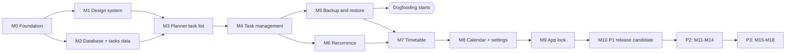

# Life kernel — Implementation Plan

| | |
|---|---|
| **Version** | 0.1 (Draft) |
**Status (author-reported 2026-10-25):** T-001 to T-007 complete; T-008 next. Record acceptance evidence in `progress-tracker.md`.
| **Derived from** | `PRD.md`, `ARCHITECTURE.md`, `DATABASE_SCHEMA.md`, `code-standards.md`, `ai-workflow-rules.md` |
| **Last updated** | 2026-10-24 |

## How to use this plan

- Work **one task at a time**, in order, unless a task says it can run in parallel. Tell the agent the task ID, for example "work only on T-007".
- Every task must satisfy the rules in `ai-workflow-rules.md` ("Before Moving to the Next Unit") and the Definition of Done below.
- **Detail level:** P1 tasks T-001 to T-011 are written in full because they come first. Later P1 tasks (T-012 onward) are specified in compact form and get a full card when the previous milestone is done, so their details reflect what was learned. P2 and P3 are outlined at milestone level and detailed at the start of each phase. This is deliberate: precise plans for work far away go stale.
- Tasks marked **(author)** are done by you, not the agent.
- If a task is too large to verify quickly, split it and record the split in `progress-tracker.md`.

## Definition of Done (every task)

1. Behavior works end to end within the task's scope and acceptance criteria.
2. Required tests exist and pass (`./gradlew testDebugUnitTest`; instrumentation or UI tests when the task touches data or UI).
3. `./gradlew assembleDebug` and `./gradlew lintDebug` pass with no new errors.
4. No invariant in `ARCHITECTURE.md` is violated; no hardcoded design values; no new permission or dependency without approval.
5. If the schema changed: migration plus migration test, and the backup registry is updated.
6. If UI: 48dp touch targets, accessibility semantics, correct with animations off.
7. Documentation updated in the same change (see each task's "Docs" line), including `progress-tracker.md`.
8. You have reviewed the change and understood it.

## Milestone overview

**Dogfooding checkpoint (DC-1):** after M5 you have tasks, the planner, and a working backup. Start using the app daily from here. Real use will reshape M6 onward.

---

## M0 — Foundation

### T-001 Create the project **(author)**
- **Objective:** A blank Compose app that builds and runs on a device, in a git repo with the docs.
- **Prerequisites:** Android Studio (current stable) with SDK installed; a phone with USB debugging or an emulator; app name and application ID chosen (OQ-01). A temporary ID is acceptable only until you share a build with friends.
- **Affected areas:** repository root, `docs/`, root agent file (for example `CLAUDE.md` that says "Read `docs/ai-workflow-rules.md` first").
- **Expected behavior:** Wizard project: Compose "Empty Activity" template, Kotlin, Kotlin DSL, minimum SDK API 26. Run it once. `git init`, keep the generated `.gitignore`, commit, push to a private remote. Copy all docs into `docs/` and commit.
- **Acceptance criteria:** App launches on your device. `./gradlew assembleDebug` passes. Docs are in the repo.
- **Tests:** none (build check).
- **Docs:** record in `progress-tracker.md` the exact tool and library versions the wizard chose, the device, and the application ID status. Check those versions against current official docs.
- **Risks:** wizard defaults may differ from what the docs assume; the application ID is hard to change once published.

### T-002 Build configuration and manifest baseline
- **Objective:** Make release builds shrunk and the manifest minimal, and establish the permission baseline.
- **Prerequisites:** T-001.
- **Affected areas:** module `build.gradle.kts`, version catalog, `AndroidManifest.xml`, R8 rules.
- **Expected behavior:** Release build type uses code and resource shrinking. Manifest requests no permissions. `allowBackup` is provisionally set to false until `PRIVACY_SECURITY.md` decides how Android's automatic backup is handled; flag this as open in the tracker. Dependencies are the wizard's, nothing added. Final decision (ADR-014): `allowBackup` is false and extraction rules exclude all data; confirm the merged manifest matches and record the permission list.
- **Acceptance criteria:** Release build installs and runs. Merged manifests (debug and release) are inspected and any permission present is listed in the tracker; the release manifest contains no INTERNET permission.
- **Tests:** manual manifest inspection recorded; automated check comes in T-034.
- **Docs:** tracker (permissions list, `allowBackup` open question).
- **Risks:** shrinking can break libraries that use reflection (Room, serialization); verify the release build actually runs.

### T-003 Package skeleton and core utilities
- **Objective:** Create the architecture's skeleton and the few shared utilities everything else needs.
- **Prerequisites:** T-002.
- **Affected areas:** `PersonalOsApp`, `di/AppContainer`, `core/time` (Clock), `core/result` (AppResult), a logging wrapper, test sources.
- **Expected behavior:** Application class builds the `AppContainer` lazily. `Clock` interface with a system and a fixed implementation. `AppResult` sealed type for expected failures. Logging wrapper that never accepts user content in release. Only packages that contain code are created now.
- **Acceptance criteria:** Unit tests pass. A layer-boundary test fails if a file under `domain/` imports `android.*`, Compose, Room, or DataStore; prove it fails by seeding a temporary violation, then remove it.
- **Tests:** Clock tests, AppResult tests, layer-boundary test.
- **Docs:** resolve AQ-06 in `ARCHITECTURE.md` and the tracker.
- **Risks:** building utilities before they are needed; keep each tiny.

### T-004 Baseline measurements **(author with agent)**
- **Objective:** Record baselines so later changes are measured, not guessed.
- **Prerequisites:** T-002.
- **Affected areas:** `progress-tracker.md`.
- **Expected behavior:** On your phone, record release package size, cold start time, and idle memory of the blank release build, with the method used.
- **Acceptance criteria:** A "Measurements" table in the tracker with values, device, Android version, and method.
- **Tests:** none.
- **Docs:** tracker; method reused later in `TEST_PLAN.md`.
- **Risks:** emulator numbers differ from a real device; use the phone.

---

## M1 — Design system

### T-005 Design tokens and theme
- **Objective:** Implement the tokens in `ui-context.md` and the palette architecture in `design-system.md`.
- **Prerequisites:** T-003.
- **Affected areas:** `core/designsystem/theme/` (colors, type, spacing, shapes, motion, palettes), Material `ColorScheme` mapping.
- **Expected behavior:** `PosTheme(palette)` provides `PosColors`, typography, spacing, radii, borders, motion durations, and `LocalReducedMotion`. Registry of seven palettes with Lime default. Derived accent tokens computed from `accent`. Unknown palette id falls back to default. A debug-only screen shows the tokens.
- **Acceptance criteria:** All seven palettes render; accent change updates every token consumer; reading system animation settings sets `LocalReducedMotion` (verify on the device, as noted in `design-system.md`).
- **Tests:** unit test computing contrast ratios from tokens (accent vs background and surfaces; `onAccent` vs accent) with the thresholds in `design-system.md`; palette fallback test; Compose test that switching palette changes the accent.
- **Docs:** update `ui-context.md` if any value changes; decide DQ-05 (`#000000` or `#050505`) after viewing on your phone.
- **Risks:** hardcoded values creeping in; Material defaults (ripples, surfaces) leaking through.

### T-006 Core components
- **Objective:** Build the components needed for the first screens.
- **Prerequisites:** T-005.
- **Affected areas:** `core/designsystem/components/`.
- **Expected behavior:** `PosButton` (primary, secondary, text), `PosCard`, `PosTextField`, `PosCheckbox`, `PosChip`, `PosSegmentedToggle`, `PosBanner`, `PosProgressBar`, `PosEmptyState`, `PosErrorState`, per `design-system.md`, including the press-translate offset behavior and reduced-motion. A debug gallery shows them in all palettes. Sheet, dialog, and drawer wrappers are added when first used.
- **Acceptance criteria:** Each component matches its spec states; 48dp touch targets; semantics expose role, state, and label.
- **Tests:** Compose UI tests for checkbox and toggle state, semantics, minimum target size, and reduced-motion behavior.
- **Docs:** `design-system.md` if specs change.
- **Risks:** time sink; build only what is listed.

---

## M2 — Database and task data layer

### T-007 Room v1 and task DAOs
- **Objective:** Create database version 1 exactly as specified.
- **Prerequisites:** T-003; priority levels decided (DB-V6 / DQ-01); Room dependency approved by an ADR.
- **Affected areas:** `data/local/` (database, entities `tags`, `tasks`, `task_tags`, `task_completions`, DAOs, type converters), build config for Room, committed `schemas/`.
- **Expected behavior:** Tables, indexes, foreign keys, and unique constraints per `DATABASE_SCHEMA.md` sections 6.1 to 6.4. Converters for date-only text and enum codes. Schema export on.
- **Acceptance criteria:** Database opens; DAO CRUD works; cascades and SET NULL fire; unique constraints hold; indexes exist; schema JSON committed.
- **Tests:** in-memory DAO tests for each DAO; foreign-key enforcement test (DB-V1); check on CHECK-constraint support (DB-V2); converter round-trips and invalid-date handling; empty-database behavior.
- **Docs:** mark DB-V1, DB-V2 resolved in `DATABASE_SCHEMA.md`; add ADR for Room; tracker.
- **Risks:** schema mistakes become migrations later; review the entities against the doc line by line before real data goes in.

### T-008 Task domain, repository, and use cases
- **Objective:** Business logic and repository for one-off tasks (recurrence and subtasks come later).
- **Prerequisites:** T-007.
- **Affected areas:** `domain/model`, `domain/repository`, `domain/usecase`, `data/repository` (mappers, `TaskRepositoryImpl`).
- **Expected behavior:** Create, update, delete, complete, and reopen. Completion is one transaction: insert completion (with `completed_at` from the Clock and `completed_on` as the local date) and set status. Reopen removes the completion. Observe-flows for overdue, today, completed today, and counts. Validation from `DATABASE_SCHEMA.md` section 2.4. Entities never leave `data/`.
- **Acceptance criteria:** All behavior covered by tests below; the layer-boundary test still passes.
- **Tests:** repository tests with in-memory Room and a fixed Clock: complete, reopen, double-complete rejected, delete cascades, validation failures, `completed_on` stable after a time-zone change, empty database, Flow re-emission on change.
- **Docs:** tracker; `ARCHITECTURE.md` if boundaries change.
- **Risks:** leaking Room types upward; transaction boundaries.

---

## M3 — Planner task list (first usable slice)

### T-009 App shell and navigation
- **Objective:** The drawer-based shell.
- **Prerequisites:** T-006.
- **Affected areas:** `MainActivity`, `navigation/`, `core/designsystem` (drawer, top bar), placeholder Home and Settings destinations.
- **Expected behavior:** Single activity, one NavHost, modal drawer opened from a hamburger, Home as start destination, drawer entries from one list showing only built destinations, state saved and restored when switching, back closes the drawer first.
- **Acceptance criteria:** FR-NAV-001, 002, 003, 005, 006 hold: opens on Home; selecting a destination closes the drawer and navigates; back behavior per `design-system.md`; rotation preserves state.
- **Tests:** Compose navigation tests: start destination, drawer selection, back handling, state restoration after recreation.
- **Docs:** tracker; `ARCHITECTURE.md` navigation section if anything differs.
- **Risks:** duplicate destinations; lost scroll state; drawer accessibility.

### T-010 Planner — tasks view
- **Objective:** Home screen showing today's task list.
- **Prerequisites:** T-008, T-009.
- **Affected areas:** `feature/planner/` (Screen, ViewModel, UiState, components).
- **Expected behavior:** Date and weekday header, progress card (done over total, bar), sections Overdue, Today, and a collapsed Done; empty state; completing a task updates counts immediately; lazy list with stable keys. The Tasks/Timetable toggle is not shown yet (added in T-030).
- **Acceptance criteria:** FR-PLAN-001, 003, 007, 009. Overdue and today are separated by date; counts match the data; "today" updates correctly if the app stays open across midnight (re-evaluated on resume, no polling).
- **Tests:** ViewModel tests with a fake repository and fixed Clock (including midnight rollover and empty states); Compose rendering tests; semantics for each row.
- **Docs:** tracker.
- **Risks:** day rollover while the app is open; recomposition cost of the list.

### T-011 Quick-add and completion transition
- **Objective:** Fast capture and satisfying completion.
- **Prerequisites:** T-010.
- **Affected areas:** `feature/planner/`, `core/designsystem` (sheet wrapper).
- **Expected behavior:** Quick-add button opens a bottom sheet with a focused title field, date chips (Today, Tomorrow, Pick date), and priority; the keyboard's Done action saves. Title-only save takes two interactions: open the sheet, type and press Done. Completing a task plays the 220 ms transition, or an instant change under reduced motion.
- **Acceptance criteria:** SM-03 met; empty title rejected with an inline message; the saved task appears at once and survives process death.
- **Tests:** Compose flow test for add; ViewModel validation tests; instrumentation test that data persists after the app process is killed and restarted; reduced-motion variant.
- **Docs:** tracker; mark SM-03 verification result.
- **Risks:** keyboard and insets behavior; Done-action handling across keyboards.

---

## M4 to M10 — Remaining P1 tasks (compact form)

Full cards are written when the preceding milestone finishes. Each task still follows the Definition of Done.

| ID | Objective | Prerequisites | Covers | Key acceptance and tests |
|---|---|---|---|---|
| **M4 Task management** | | | | |
| T-012 | Settings v0: theme selector and default planner view, stored in DataStore | T-009, T-005 | FR-SET-001, 002 (partial), FR-UI-003, 005 | Theme persists across restart; unknown id falls back; DataStore tests; smooth 160 ms theme transition |
| T-013 | Task detail, edit, delete with confirmation | T-011 | FR-TASK-001, 002, 003 | Confirmation names what is deleted; edit completed task works; DAO and UI tests |
| T-014 | Tags on tasks (tag picker, orphan cleanup) | T-013 | FR-TASK-006 | Orphan tag removed in the same transaction; case-insensitive uniqueness test |
| T-015 | Tasks screen: Today, Upcoming, Overdue, Completed, All; sort, filter, search (LIKE) | T-014 | FR-TASK-008, 009, 010 | Each view matches definitions; search limit; large-list (10k) scroll check |
| T-015a | Planner "Upcoming" section: tasks due in the next 7 days, collapsed by default | T-015 | FR-PLAN-006 | Window is 7 days; excludes overdue and today; ViewModel tests with a fixed clock |
| T-016 | Subtasks (depth 1) | T-013 | FR-TASK-004 | Domain rules: depth, recurring-parent forbidden (later), cascade delete; tests |
| **M5 Backup and restore** | | | | |
| T-017 | Backup archive writer: ZIP, manifest, JSONL per table, SHA-256, backup registry test | T-016, `DATABASE_SCHEMA.md` §11 | FR-BKP-001, 002 | Round-trip equals original; registry test fails if a table is missing; kotlinx.serialization ADR |
| T-018 | Restore: validate fully, replace atomically | T-017 | FR-BKP-006, 007 | Truncated, corrupted, wrong-version, invalid-row archives rejected with data unchanged; interrupted-operation test; DB-V5 resolved |
| T-019 | Folder picker, persisted permission, retention (last N), last-backup info, backup screen | T-017 | FR-BKP-003, 008, 009, 011 | Permission lost handled gracefully; temp file naming; low-storage error; airplane-mode run. Keep the last 5 matching files; file names `{app}-backup-YYYYMMDD-HHmm.zip`.|
| T-020 | Dirty flag via invalidation tracker and the backup banner | T-019, T-010 | FR-NTF-001 to 005 | AQ-01 verified on a real device: no banner on fresh install or unchanged data; snooze works; restart persistence, Snooze 24 hours. |
| T-021 | Data deletion and unencrypted-backup warning | T-018 | FR-BKP-005, 010 | Typed confirmation; data really gone; warning shown |
| T-022 | Optional password-encrypted backup | T-021, `PRIVACY_SECURITY.md` section 10.2 | FR-BKP-004, SEC-SEC-003 | PBKDF2-HMAC-SHA256 (iterations calibrated and recorded, SV-03) and AES-256-GCM with platform crypto; authenticated header; password typed twice and never stored; 32 MiB ceiling validated (SV-04); wrong password, tampered file, and bad header leave data unchanged; `.zip.enc` file name; no custom primitives |
| **M6 Recurrence** | | | | |
| T-023 | Recurrence rule engine (domain) | T-008 | FR-TASK-005 | `DATABASE_SCHEMA.md` §13 rules; month-end clamp, leap day, weekly masks, until-date, large intervals; exhaustive unit tests |
| T-024 | Recurring tasks: complete advances due date; undo last completion | T-023 | FR-TASK-005 | Single-transaction behavior; completing late does not shift schedule; undo restores date |
| **M7 Timetable** (Room v2) | | | | |
| T-025 | `categories`, `time_blocks`, `time_block_entries` migration 1→2 and repository | T-024 | FR-TIME-001, 002 | Migration test with data; backup registry updated; DAO tests; midnight-spanning block stored correctly |
| T-026 | Overlap rule (domain) and day timetable view | T-025 | FR-TIME-005 | Touching is not overlap; spillover from previous day shown; conflict marked with icon and label |
| T-027 | Block create, edit, move, delete; categories; link to task | T-026 | FR-TIME-002, 003 | Deleting a task nulls the link; recurring blocks cannot link a task |
| T-028 | Planned versus actual duration | T-027 | FR-TIME-006 | Stored as minutes, not clock subtraction; DST-day test |
| T-029 | Recurring blocks and skip occurrence | T-023, T-027 | FR-TIME-007 | Edit applies to series; skip creates an entry; expansion tests across month ends |
| T-030 | Planner Timetable view, Now/Next strip, Tasks/Timetable toggle with default | T-029, T-012 | FR-PLAN-002, 004, 005, 008 | Now/Next correct at boundaries and across midnight; toggle keeps scroll state |
| **M8 Calendar and settings** | | | | |
| T-031 | Week and month calendar, date navigation, return to today | T-030 | FR-TIME-004, 008 | Week-start setting honored; leap-year and month-boundary tests; item dots per day |
| T-032 | Settings complete: week start, date/time format, privacy screen, storage info, about | T-031 | FR-SET-002 to 007 | Privacy text matches the actual guarantees in `PRIVACY_SECURITY.md` |
| **M9 App lock** | | | | |
| T-033 | Optional app lock, honestly labeled | ADR for the AndroidX biometric library | FR-SET-003, SEC-SEC-002 | System prompt for biometric or device screen lock; locked on cold start and after 30 s in the background; secure window flag while enabled (SV-06); fallback verified on an older Android emulator (SV-02); cannot be enabled without a device lock; opens with a notice if the device lock is later removed; no stored secrets; wording "lock, not encryption" |
| **M10 P1 release candidate** | | | | |
| T-034 | Release audits: merged manifest, dependency network audit, exported components, airplane-mode checklist | T-033 | SEC-PRIV-004, 005, SEC-OFF-003, SM-04, SM-07 | Automated manifest check added; checklist recorded in `TEST_PLAN.md` results |
| T-035 | Measurements and fixes: size, start-up, memory, scroll with large data, accessibility pass | T-034 | NFR-PERF-001 to 004, NFR-SIZE-001, NFR-A11Y | Numbers recorded against T-004 baselines; every screen passes the accessibility checklist |
| T-036 | Signed build for friends **(author with agent)** | T-035 | D-11 | Create and back up the signing key in two places (never commit it); application ID final; install on a second device; "backup, upgrade, verify" run |

---

## P2 — Daily life (outline; full cards at phase start)

Each module follows the same pattern: schema migration with tests, backup registry update, domain rules with tests, repository, screens, drawer entry, accessibility pass.

| Milestone | Contents | Notes |
|---|---|---|
| M11 Resources | Collections, resources, tags, icons and colors, open-in-browser, copy URL, offline search | Simplest P2 module; verifies the URL-only rule and the no-INTERNET manifest |
| M12 Notes and journal | Notes, folders, journal (one per date), pinning, archive, links, lightweight Markdown, autosave | DB-V4: measure `LIKE` search on a large dataset and decide on FTS |
| M13 Habits and trackers | Habits, entries, schedules, streaks, measurable habits | Streak and schedule rules fully tested before UI |
| M14 Goals and projects | Goals, progress methods, milestones, projects, task links (adds `tasks.project_id`, `tasks.goal_id`, DB-V3) | Progress formulas from `DATABASE_SCHEMA.md` §7.2 |

## P3 — Insights (outline)

| Milestone | Contents |
|---|---|
| M15 Analytics engine | Metrics and rule engine as pure Kotlin per `ANALYTICS_SPEC.md`, with unit tests; no UI |
| M16 Charts and heatmaps | Decide native drawing versus library (OQ-06); activity heatmap, trends, comparisons; categorical colors (DQ-03) |
| M17 Insights | Rule-based insights with explanation, period, and supporting data; configurable thresholds; minimum sample sizes |
| M18 AI-readable export | Module exporters, summary header, date range and module selection, warning, streaming output, share sheet |

## P4 — Finance (not planned in detail)

Starts only after P3 and after the author uses the app for a while. Scope is the reserved design in `DATABASE_SCHEMA.md` §12; wireframes and a full task breakdown are written then.

---

## Requirement traceability (P1 groups)

| Requirement group | Tasks |
|---|---|
| FR-NAV | T-009, T-011, T-032 |
| FR-PLAN | T-010, T-030 |
| FR-TASK | T-008, T-011, T-013 to T-016, T-023, T-024 |
| FR-TIME | T-025 to T-031 |
| FR-BKP | T-017 to T-022 |
| FR-NTF | T-010, T-020, T-030 |
| FR-SET | T-012, T-032, T-033 |
| FR-UI | T-005, T-006, T-012 |
| NFR-PERF, NFR-SIZE, NFR-A11Y | T-004, T-035 |
| SEC-PRIV, SEC-SEC, SEC-OFF | T-002, T-022, T-033, T-034 |

A per-ID matrix (every requirement to a task and a test case) is built with `TEST_PLAN.md` and checked in the documentation validation report.

---

## Parallelism and ordering notes

- M1 and M2 can run in parallel after M0.
- Do not start M7 before M5; real data deserves a working backup before more schema changes.
- Any task that changes the schema runs only after the previous schema version has a verified backup and migration test.
- P2 modules are independent of each other and may be reordered, except M14 (goals) which touches `tasks`.
- Reorder freely after DC-1 based on what daily use shows, but record the change in the tracker.

---

## Roadmap summary

**Current position (author-reported):** T-001 to T-007 complete; T-008 next. Record acceptance evidence in `progress-tracker.md`.

**Priorities**
- Must (P1 MVP): drawer navigation, planner task view, quick-add, task CRUD and completion, tags, task views and search, backup and restore with the nudge, theme selector, basic settings.
- Should (P1): recurring tasks, subtasks, time blocks and timetable, calendar views, overlap detection, planned versus actual, Now/Next strip, encrypted backup, app lock.
- Should (P2): resources, notes and journal, habits and streaks, goals and projects.
- Should (P3): analytics, heatmap, trends, rule-based insights, AI-readable export.
- Later (P4): full finance.

**Gates**
- P1 to P2: M10 audits pass and the author has used the app daily for 14 days.
- P2 modules are independent, except goals, which add columns to `tasks`.
- P3 starts after habit and time data exist to analyze.
- P4 starts only after reviewing real use of P1 to P3.

**Hard dependencies:** backup before schema growth beyond tasks; recurrence before recurring blocks; analytics before charts and insights.

**Deferred or excluded:** finance (P4); any AI inside the app; cloud sync, accounts, multi-device; system notifications (one opt-in daily notification reconsidered after at least 4 weeks of use); home-screen widget; database encryption (revisit before a Play Store release or finance); streaming encryption for backups over 32 MiB; full-text search unless `LIKE` search measures too slow; editing a single occurrence of a recurring block; merge-style backup import; editable insight thresholds; multiple currencies and net worth; localization and tablet layouts.

**Review cadence:** update this section after every milestone; after the first week of daily use (after M5) review the order of M6 to M10.